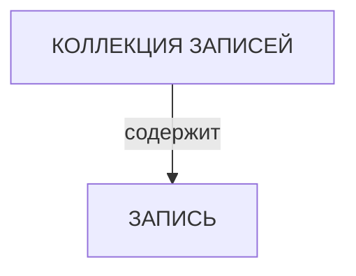
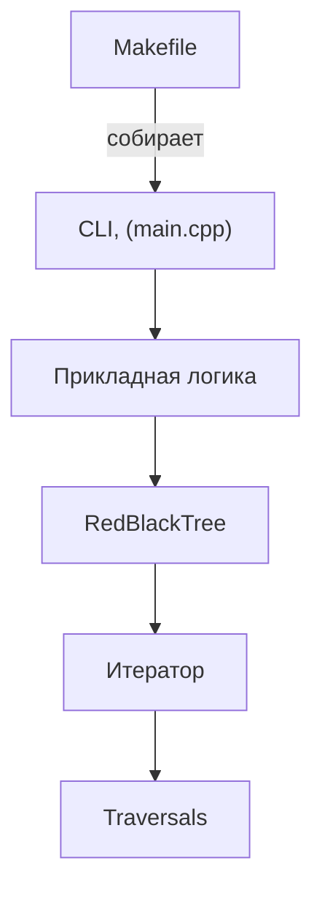

# Дизайн

## Проект: Библиотека ассоциативного контейнера «Красно-чёрное дерево» с консольным интерфейсом

## 1. Постановка задачи

### 1.1. Идея и концепция

Разрабатывается программный комплекс, реализующий **ассоциативный контейнер на основе красно-чёрного дерева** — самобалансирующегося бинарного дерева поиска с гарантированной логарифмической сложностью базовых операций (`O(log n)`).

### 1.2. Область применения

Реализованная программа относится к общему классу **систем управления ассоциативными данными** и может быть применена в задачах:

- **Хранение и быстрый поиск** записей по уникальному идентификатору (справочники, реестры, индексы).
- **Упорядоченное представление данных** с возможностью обхода в различных стратегиях (отчёты, журналы, хронологии).
- **Агрегация и фильтрация** коллекций (подсчёт сумм, выборка по условию, преобразование значений).
- **Объединение и сравнение** наборов данных (слияние справочников, проверка вхождения).
- **Учебные и исследовательские цели** — демонстрация работы самобалансирующихся деревьев, функционального программирования на C++, шаблонов проектирования «Стратегия» и «Посетитель».

---

## 2. Сущности прикладной задачи

### 2.1. Описание сущностей

Ниже перечислены сущности, специфичные для **прикладной задачи** (хранение и обработка структурированных данных), а не сущности решения (узел дерева, цвет, поворот и т.п. — это детали реализации контейнера).

| Сущность | Описание |
|---|---|
| **Запись** | Пара «ключ — значение». Базовая единица хранения в коллекции. |
| **Коллекция записей** | Упорядоченное множество записей с уникальными ключами. Поддерживает операции поиска, добавления, удаления. |

### 2.2. Связи между сущностями

---

## 3. Архитектура

### 3.1. Компоненты системы    \\ сделаем табличкой/списком

1. КОНСОЛЬНЫЙ ИНТЕРФЕЙС (CLI): main.cpp, Меню выбора типа данных, Меню операций над деревьями, Ввод/вывод, валидация пользовательского ввода;
2. ВСПОМОГАТЕЛЬНЫЕ КОМПОНЕНТЫ ДЛЯ ДЕМОСТРАЦИИ РАБОТЫ БИБЛИОТЕКИ: Типы данных, Алиасы типов деревьев;
3. КОМПОНЕНТ СТРУКТУРЫ ДАННЫХ: Библиотека rbTree.h;
4. СТРАТЕГИИ ОБХОДА: traversals.h, 6 стратегий, Передача стратегии как шаблонного параметра
5. ИНТЕРФНЕЙС ИТЕРАТОРА 
6. ИНФРАСТРУКТУРНЫЕ КОМПОНЕНТЫ: Makefile: Сборка CLI, Сборка с санитизерами, Запуск целей

### 3.2. Связи между компонентами

### 3.3. Ключевые решения, структуры данных и алгоритмы

#### Узел

Содержит сами ключ и значение шаблонного типа, указатели на родительский, левый и правый узлы, поле цвета (false - красный, true - черный). Конструктор узла изначально направляет все указатели на служебный узел дерева nil.

#### Красно-чёрное дерево 

Шаблон класса задаёт типы ключей и значений. Компаратор по умолчанию -- std::less, также может быть задан пользователем, при этом производиться проверка того, что ключи сравнимы с помощью него и сравнимы строго. 
Поля класса -- служебный пустой узел, корневой узел, функция сравнения (компаратор).

#### Обходы

6 шаблонных структур, в каждой из которых перегрузка оператора () задаёт последовательность выполнения функций посещения левого поддерева, правого поддерева и текущего узла.

#### Итератор

Итератор дерева наследуется от интерфейса итератора с виртуальными функциями. Получение итератора: по умолчанию задаёт обход ЛКП, имеет перегрузки с заданием набора путей к узлам пользователем, а также с шаблоном, где через него передаётся класс одного из 6 стандартных обходов.

#### Операции дерева

Вставка, удаление выполнены с помощью поворотов узлов и перекрашиваний. Обход, map, where, reduce, merge используют итератор. Сравнение поддеревьей, копирование и удаление поддеерева -- рекурсивные. 

#### Сериализация и десериализация

В этих операциях записи дерева формируются из формата и сериализаются в формат: "путь_от_корня цвет кол-во_символов_в_ключе:ключ кол-во_символов_в_значении:значение". 
При десериализации: Сначала проверяется заголовок строки. Затем последовательно читаются записи: путь узла от корня, цвет, ключ и значение. Границы ключа и значения определяются указанными длинами.
По путям собирается временное дерево в порядке «корень → левое поддерево → правое поддерево». После этого проверяются порядок ключей и свойства красно-чёрного дерева.
Если всё корректно, восстановленное дерево заменяет прежнее. При ошибке временные данные удаляются, а исходное дерево сохраняется.  

---

## 4. Функциональные требования

### 4.1. Требования к записи (паре «ключ — значение»)

| Действие | Особые сценарии |
|---|---|
| Создать запись | При некорректных данных (неверная дата, отрицательный курс, ID функции вне диапазона 0–3) — отклонить создание с исключением. |
| Сравнить две записи | Сравнение по ключу (для упорядочения) и по значению (для проверки равенства). |
| Сериализовать запись | Строки и ФИО должны корректно обрабатывать пробелы, кавычки, переносы строк. |
| Десериализовать запись | При несовпадении формата — установить `failbit` у потока, не бросая исключение. |

### 4.2. Требования к коллекции записей (дереву)

| Действие | Особые сценарии |
|---|---|
| **Добавить запись** | Если ключ уже существует — операция игнорируется, прежнее значение сохраняется. |
| **Удалить запись по ключу** | Если ключ не найден — вернуть `false`, дерево не изменяется. При удалении узла с двумя детьми используется максимум левого поддерева. |
| **Найти запись по ключу** | Если ключ не найден — вернуть `nullptr`. |
| **Проверить пустоту** | — |
| **Обойти элементы** | Поддерживаются 6 стратегий обхода. Пользователь может задать собственную стратегию. |
| **Преобразовать значения (`map`)** | Возвращает новую коллекцию; оригинал не изменяется. |
| **Отфильтровать по условию (`where`)** | Возвращает новую коллекцию, содержащую только записи, удовлетворяющие предикату. |
| **Свернуть значения (`reduce`)** | Принимает начальное значение и бинарную операцию. Поддерживает все 6 стратегий обхода. |
| **Слить две коллекции (`merge`)** | При совпадении ключей сохраняется значение из первой коллекции (приоритет). Используется компаратор первой коллекции. |
| **Извлечь поддерево по ключу** | Возвращает новую коллекцию — поддерево, корнем которого является узел с указанным ключом. Если ключ не найден — возвращается пустая коллекция. |
| **Проверить вхождение поддерева** | Проверяет структурное равенство: существует ли в данной коллекции поддерево, идентичное указанному (по ключам, значениям и структуре). |
| **Найти узел по пути** | Путь задаётся строкой из символов `L`, `R` (и `U` для относительного пути). Пустой путь возвращает начальный узел. Недопустимые символы — ошибка. |
| **Сериализовать в строку** | Формат: заголовок `RBT\n`, затем записи в фиксированном порядке (NLR) с указанием пути, цвета, длин и содержимого ключа/значения. |
| **Восстановить из строки** | Отклонять строки с неверным заголовком, нарушениями BST-порядка, двумя красными узлами подряд, неравенством чёрных высот, несовпадением длин полей. При отклонении уже созданные узлы освобождаются. |
| **Скопировать коллекцию** | Глубокое копирование; оригинал и копия независимы. |
| **Переместить коллекцию** | Источник переходит в валидное пустое состояние. |

### 4.3. Требования к интерфейсу

| Требование | Описание |
|---|---|
| **Поддержка 7 типов коллекций** | Целые числа, вещественные числа, комплексные числа, строки, функции, студенты, преподаватели. |
| **Работа с тремя экземплярами** | Деревья `A`, `B`, `R`; операции слияния/извлечения записывают результат в `R`. |
| **Интерактивный ввод** | Все операции через меню с валидацией ввода. Повторный запрос при ошибке. |
| **Проверка корректности** | Операция «Проверить свойства дерева» — валидация всех инвариантов КЧ-дерева и корректности данных (конечность чисел, совпадение ключей с ID персон). |
| **Обработка ошибок** | Перехват `std::bad_alloc` (нехватка памяти), `std::exception` (ошибки данных), вывод понятных сообщений пользователю. |
| **Кроссплатформенность** | Корректная работа с UTF-8 на Windows (через `SetConsoleCP`) и Unix-системах. |
| **Производительность** | Операции вставки, поиска, удаления — `O(log n)`. Корректная балансировка при вставке отсортированных последовательностей до 10⁷ элементов. |

