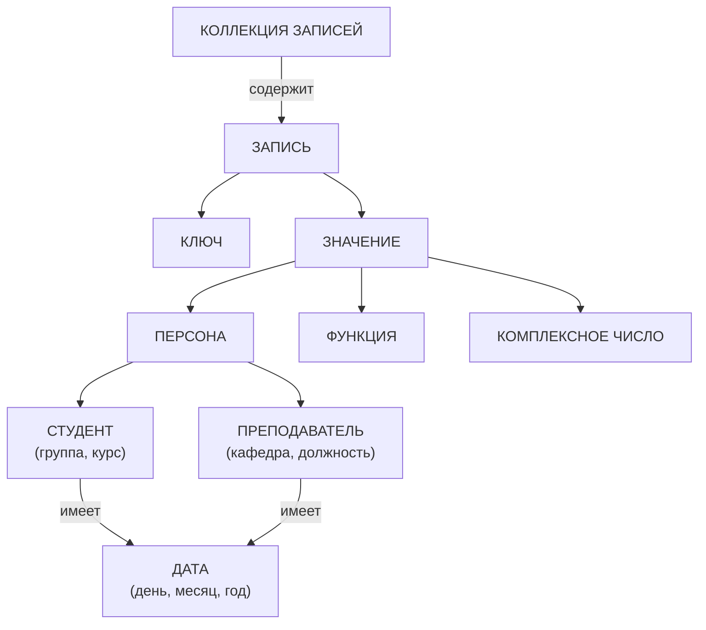
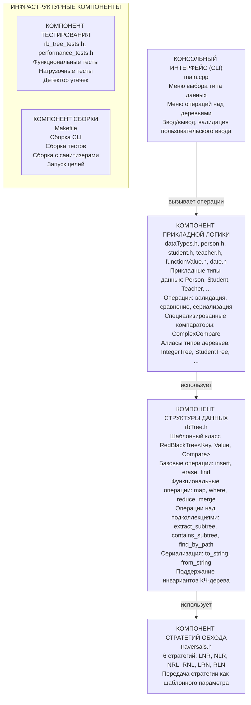
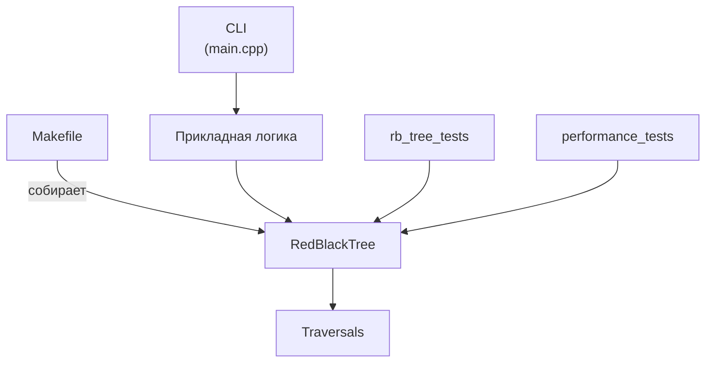

# Техническое задание (Дизайн)

## Проект: Библиотека ассоциативного контейнера «Красно-чёрное дерево» с консольным интерфейсом

---

## 1. Постановка задачи

### 1.1. Идея и концепция

Разрабатывается программный комплекс, реализующий **ассоциативный контейнер на основе красно-чёрного дерева** — самобалансирующегося бинарного дерева поиска с гарантированной логарифмической сложностью базовых операций (`O(log n)`).

Концептуально система представляет собой **универсальный словарь** (key-value хранилище), в котором:

- каждый элемент однозначно идентифицируется ключом;
- порядок элементов поддерживается автоматически за счёт инвариантов красно-чёрного дерева;
- поддерживается работа с разнородными прикладными типами данных (числа, строки, комплексные числа, предметные сущности вроде студентов и преподавателей);
- доступны функциональные операции высшего порядка (отображение, фильтрация, свёртка, слияние);
- реализована сериализация дерева в строку и восстановление из неё с сохранением всех инвариантов;
- предусмотрен интерактивный консольный интерфейс для работы с несколькими экземплярами деревьев одновременно.

### 1.2. Область применения

Реализованная программа относится к общему классу **систем управления ассоциативными данными** и может быть применена в задачах:

- **Хранение и быстрый поиск** записей по уникальному идентификатору (справочники, реестры, индексы).
- **Упорядоченное представление данных** с возможностью обхода в различных стратегиях (отчёты, журналы, хронологии).
- **Агрегация и фильтрация** коллекций (подсчёт сумм, выборка по условию, преобразование значений).
- **Объединение и сравнение** наборов данных (слияние справочников, проверка вхождения).
- **Учебные и исследовательские цели** — демонстрация работы самобалансирующихся деревьев, функционального программирования на C++, шаблонов проектирования «Стратегия» и «Посетитель».

---

## 2. Сущности прикладной задачи

### 2.1. Описание сущностей

Ниже перечислены сущности, специфичные для **прикладной задачи** (хранение и обработка структурированных данных), а не сущности решения (узел дерева, цвет, поворот и т.п. — это детали реализации контейнера).

| Сущность | Описание |
|---|---|
| **Ключ** | Уникальный идентификатор записи. Определяет положение записи в упорядоченной коллекции. Может быть числом, строкой, идентификатором персоны. |
| **Значение** | Полезная нагрузка записи. Хранит информацию, ассоциированную с ключом. |
| **Запись** | Пара «ключ — значение». Базовая единица хранения в коллекции. |
| **Коллекция записей** | Упорядоченное множество записей с уникальными ключами. Поддерживает операции поиска, добавления, удаления. |
| **Подколлекция** | Выделенная часть коллекции (поддерево), сама являющаяся корректной коллекцией. |
| **Путь навигации** | Последовательность направлений (влево / вправо / к родителю), задающая маршрут от узла к узлу. |
| **Стратегия обхода** | Правило посещения элементов коллекции (например, «сначала левые, потом текущий, потом правые»). |
| **Дата** | Календарная дата (день, месяц, год) с проверкой корректности и учётом високосных лет. |
| **Комплексное число** | Число вида `a + bi`, используемое в математических вычислениях. |
| **Функция** | Именованная одноместная функция над целыми числами (тождество, чётность, знак). |
| **Персона** | Человек с идентификатором, ФИО и датой рождения. Базовая сущность для предметных типов. |
| **Студент** | Персона с дополнительной информацией: учебная группа и курс обучения. |
| **Преподаватель** | Персона с дополнительной информацией: кафедра и должность. |

### 2.2. Связи между сущностями

**Связи навигации:**

**Связи агрегации:**

**Связи преобразования:**

---

## 3. Архитектура

### 3.1. Компоненты системы

### 3.2. Связи между компонентами

### 3.3. Ключевые решения, структуры данных и алгоритмы

#### Рабочие наборы и пользовательский сценарий

Для текущего вида данных предусматриваются три рабочих набора: A, B и R. A и B удобны для подготовки исходных данных, R — для результата операции, создающей новый набор. Любой из них может быть выбран активным.

При смене вида данных текущие наборы сбрасываются. Если они непустые, пользователь должен подтвердить потерю введённых данных.

В интерфейсе предлагаются заранее определённые действия и условия, подходящие выбранному виду значений. Например, для чисел — арифметическое преобразование и проверка чётности, для студентов — изменение курса и отбор по группе.

#### Модель значений и порядок ключей

| Вид данных | Ключ | Значение и правила |
|---|---|---|
| Целые числа | Целое число | Целое число. |
| Вещественные числа | Вещественное число | Конечное вещественное число; ввод ключей также ограничен конечными числами. |
| Комплексные числа | Комплексное число | Сначала ключи сравниваются по действительной части, затем по мнимой. Части вводимых чисел должны быть конечными. |
| Строки | Строка | Текстовое значение; ключи сравниваются лексикографически. |
| Функции | Целое число | Правило из каталога: возврат аргумента, проверка чётности или определение знака. Допускается состояние «функция не выбрана». |
| Студенты | Идентификатор человека | Общие сведения о человеке, группа и курс. |
| Преподаватели | Идентификатор человека | Общие сведения о человеке, кафедра и должность. |

Идентификатор человека рассматривается как текст: ведущие нули значимы и должны сохраняться. Дата рождения должна быть календарно корректной. Курс неотрицателен; ноль означает, что курс не указан.

Порядок задаётся единым для набора правилом сравнения. Ключи эквивалентны, если ни один не предшествует другому по этому правилу. Это определяет уникальность записей.

#### Красно-чёрное дерево

Записи размещаются в двоичном дереве поиска. Каждый узел содержит одну запись и имеет цвет — красный или чёрный. Отсутствующие дочерние элементы рассматриваются как чёрные служебные листья.

После изменения дерева должны соблюдаться условия:

1. Корень и служебные листья чёрные.
2. Каждый обычный узел красный или чёрный.
3. У красного узла дети чёрные.
4. На всех путях от одного узла до служебных листьев одинаковое количество чёрных узлов.
5. Расположение ключей согласовано с правилом сравнения.

При вставке или удалении выполняются необходимые повороты и перекрашивания. Эти действия изменяют форму дерева, сохраняя порядок ключей. Равенство длин ветвей не требуется.

Выбор структуры обеспечивает логарифмическую высоту и поиск, вставку и удаление за O(log N) при постоянной стоимости сравнения и обработки отдельной записи. Хранение требует O(N) структурной памяти без учёта размера самих значений.

#### Обход и свёртка

Предусматриваются шесть порядков: NLR, NRL, LNR, RNL, LRN и RLN. Здесь N — текущая запись, L и R — соответствующие поддеревья.

Порядок обхода задаётся отдельным правилом последовательности посещения и не смешивается с действием, выполняемым над записью. Одно правило порядка может использоваться как при просмотре, так и при свёртке.

Свёртка начинается с начального результата. На каждом шаге выбранное действие получает накопленный результат и очередное значение. Для действий, чувствительных к порядку, разные обходы могут дать разные результаты.

#### Преобразование, отбор и объединение

Преобразование map строит новый набор, изменяя значения и сохраняя ключи. Отбор where переносит в новый набор записи, удовлетворяющие условию. Исходные наборы сохраняются.

Слияние создаёт новый набор: сначала обрабатываются записи первого источника, затем второго. При совпадении ключей уже внесённая запись сохраняется. По умолчанию используется порядок первого источника; допускается явно выбрать совместимое правило сравнения.

Результаты создаются как самостоятельные деревья. Их форма может отличаться от формы источников из-за последовательности вставок и балансировки.

#### Поддеревья и пути

Извлечение поддерева создаёт самостоятельную копию части структуры, начиная с записи с заданным ключом. Связи и данные сохраняются, а корень результата становится чёрным.

Вхождение проверяется по структуре, эквивалентности ключей и равенству значений. Цвета при сравнении несущественны. Наличие тех же ключей в другой структуре само по себе не означает вхождение поддерева.

Абсолютный путь начинается от корня и содержит переходы L и R. Относительный начинается от записи с заданным ключом и дополнительно допускает U — переход к родителю.

#### Сохранение и восстановление состояния

Сохраняется полное состояние дерева: расположение записей, ключи, значения и цвета. Используется один фиксированный порядок NLR, в котором родительская запись предшествует дочерним, а левое поддерево — правому.

Строковое представление включает маркер формата и записи узлов. Положение задаётся путём от корня. Для текстовых полей указываются длины, чтобы пробелы и переводы строк внутри данных не нарушали границы записей. Функция сохраняется через обозначение из каталога, по которому восстанавливается выбранное правило.

Восстановление выполняется во временном дереве. Проверяются формат, последовательность записей, пути, допустимость данных, порядок ключей и свойства красно-чёрного дерева. Текущий набор заменяется только после успешного завершения всех проверок. Это защищает имеющиеся данные при ошибке чтения.

#### Проверка решений и измерение скорости

Корректность проверяется на пустых и непустых наборах, повторных и отсутствующих ключах, граничных значениях и ошибочных входных данных. Алгоритмы проверяются со всеми поддерживаемыми видами значений.

Для сравнения скорости используется один вид данных — целочисленные ключи и значения. Подготовка источников, проверка результата и отображение выполняются вне измеряемого интервала. Освобождение удаляемых записей относится к операции удаления.

Исследуются объёмы от 10⁴–10⁵ до 10⁶–10⁸ элементов с учётом ресурсов среды. Для размера, который невозможно проверить на имеющемся оборудовании, должно быть явно указано ограничение. Пропуск не считается выполненным измерением.

---

## 4. Функциональные требования

### 4.1. Требования к записи (паре «ключ — значение»)

| Действие | Особые сценарии |
|---|---|
| Создать запись | При некорректных данных (неверная дата, отрицательный курс, ID функции вне диапазона 0–3) — отклонить создание с исключением. |
| Сравнить две записи | Сравнение по ключу (для упорядочения) и по значению (для проверки равенства). |
| Сериализовать запись | Строки и ФИО должны корректно обрабатывать пробелы, кавычки, переносы строк. |
| Десериализовать запись | При несовпадении формата — установить `failbit` у потока, не бросая исключение. |

### 4.2. Требования к коллекции записей (дереву)

| Действие | Особые сценарии |
|---|---|
| **Добавить запись** | Если ключ уже существует — операция игнорируется, прежнее значение сохраняется. |
| **Удалить запись по ключу** | Если ключ не найден — вернуть `false`, дерево не изменяется. При удалении узла с двумя детьми используется максимум левого поддерева. |
| **Найти запись по ключу** | Если ключ не найден — вернуть `nullptr`. |
| **Проверить пустоту** | — |
| **Обойти элементы** | Поддерживаются 6 стратегий обхода. Пользователь может задать собственную стратегию. |
| **Преобразовать значения (`map`)** | Возвращает новую коллекцию; оригинал не изменяется. |
| **Отфильтровать по условию (`where`)** | Возвращает новую коллекцию, содержащую только записи, удовлетворяющие предикату. |
| **Свернуть значения (`reduce`)** | Принимает начальное значение и бинарную операцию. Поддерживает все 6 стратегий обхода. |
| **Слить две коллекции (`merge`)** | При совпадении ключей сохраняется значение из первой коллекции (приоритет). Используется компаратор первой коллекции. |
| **Извлечь поддерево по ключу** | Возвращает новую коллекцию — поддерево, корнем которого является узел с указанным ключом. Если ключ не найден — возвращается пустая коллекция. |
| **Проверить вхождение поддерева** | Проверяет структурное равенство: существует ли в данной коллекции поддерево, идентичное указанному (по ключам, значениям и структуре). |
| **Найти узел по пути** | Путь задаётся строкой из символов `L`, `R` (и `U` для относительного пути). Пустой путь возвращает начальный узел. Недопустимые символы — ошибка. |
| **Сериализовать в строку** | Формат: заголовок `RBT\n`, затем записи в фиксированном порядке (NLR) с указанием пути, цвета, длин и содержимого ключа/значения. |
| **Восстановить из строки** | Отклонять строки с неверным заголовком, нарушениями BST-порядка, двумя красными узлами подряд, неравенством чёрных высот, несовпадением длин полей. При отклонении уже созданные узлы освобождаются. |
| **Скопировать коллекцию** | Глубокое копирование; оригинал и копия независимы. |
| **Переместить коллекцию** | Источник переходит в валидное пустое состояние. |

### 4.3. Требования к прикладным типам данных

| Тип | Требования |
|---|---|
| **Дата** | Валидация дня/месяца/года с учётом високосных лет. Год ≥ 1. |
| **Комплексное число** | Лексикографическое сравнение по `(real, imag)`. Проверка конечности при вводе. |
| **Функция** | 4 состояния (0 — не выбрана, 1 — identity, 2 — is_even, 3 — sign). Вызов невыбранной функции — исключение. |
| **Персона** | Идентификатор, ФИО (имя, отчество может отсутствовать, фамилия), дата рождения. Сравнение по всем полям. |
| **Студент** | Наследует Персону. Дополнительно: группа (строка), курс (≥ 0). |
| **Преподаватель** | Наследует Персону. Дополнительно: кафедра, должность. |

### 4.4. Требования к системе в целом

| Требование | Описание |
|---|---|
| **Поддержка 7 типов коллекций** | Целые числа, вещественные числа, комплексные числа, строки, функции, студенты, преподаватели. |
| **Работа с тремя экземплярами** | Деревья `A`, `B`, `R`; операции слияния/извлечения записывают результат в `R`. |
| **Интерактивный ввод** | Все операции через меню с валидацией ввода. Повторный запрос при ошибке. |
| **Проверка корректности** | Операция «Проверить свойства дерева» — валидация всех инвариантов КЧ-дерева и корректности данных (конечность чисел, совпадение ключей с ID персон). |
| **Обработка ошибок** | Перехват `std::bad_alloc` (нехватка памяти), `std::exception` (ошибки данных), вывод понятных сообщений пользователю. |
| **Кроссплатформенность** | Корректная работа с UTF-8 на Windows (через `SetConsoleCP`) и Unix-системах. |
| **Тестируемость** | Полное покрытие функциональными и нагрузочными тестами; возможность прогона под AddressSanitizer и UndefinedBehaviorSanitizer. |
| **Производительность** | Операции вставки, поиска, удаления — `O(log n)`. Корректная балансировка при вставке отсортированных последовательностей до 10⁷ элементов. |

