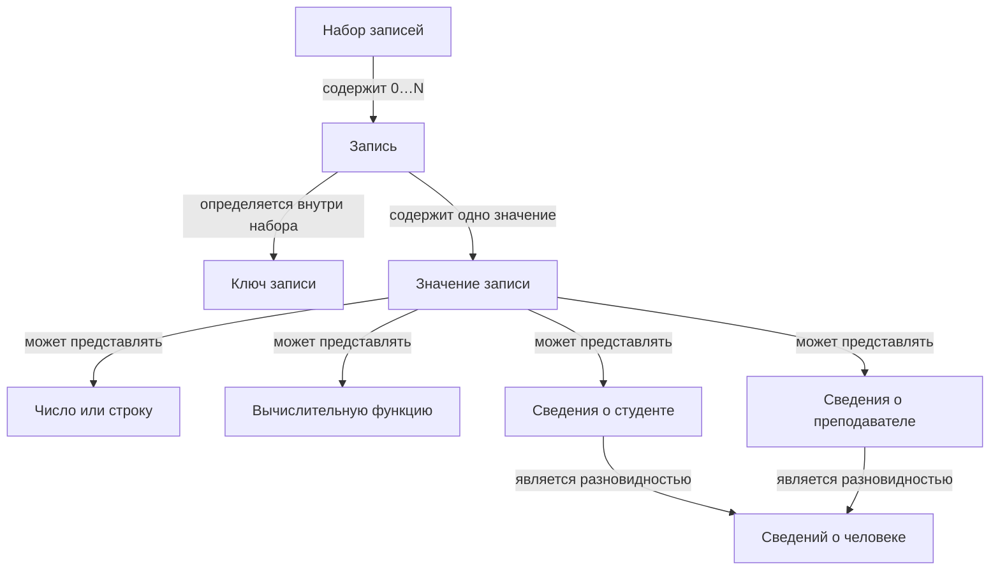
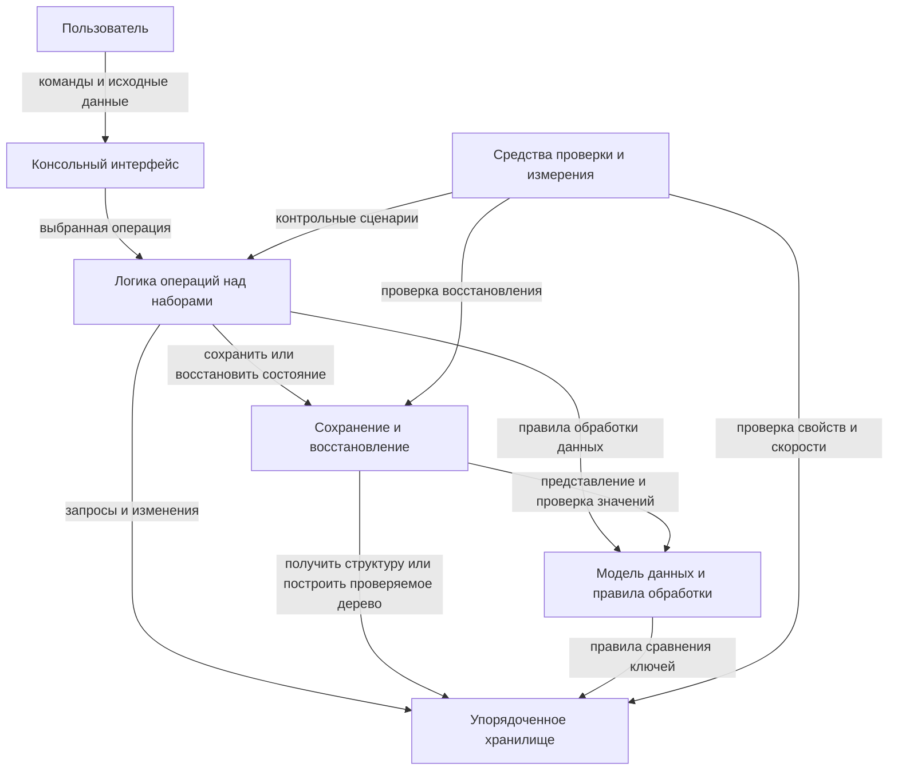

# Дизайн системы обработки упорядоченных наборов данных

## 1. Постановка задачи

### 1.1. Идея и концепция

Спроектировать систему хранения и обработки наборов записей, в которых каждая запись определяется уникальным в пределах набора ключом и содержит связанное с ним значение.

Пользователь должен иметь возможность формировать наборы, искать и удалять записи, преобразовывать и отбирать данные, получать обобщённый результат, объединять наборы и сохранять их состояние для последующего восстановления.

Для организации хранения выбирается красно-чёрное дерево. Кроме операций над содержимым система должна позволять исследовать иерархию хранения: просматривать её, выделять поддеревья, проверять их вхождение и находить элементы по пути.

Система предусматривает консольный способ взаимодействия и несколько рабочих наборов одного выбранного вида данных. Решения должны подходить для целых, вещественных и комплексных чисел, строк, функций, сведений о студентах и преподавателях.

Этот документ описывает понятия задачи, архитектуру и поведение системы на уровне проектных решений. Устройство программных файлов, синтаксис языка и конкретные средства сборки в него не входят.

### 1.2. Назначение и общий класс задач

Система предназначена для задач, в которых требуется поддерживать изменяемый набор записей с быстрым доступом по ключу и выполнять операции над всем набором.

Примеры применения:

- ведение небольших справочников студентов или преподавателей;
- обработка числовых и текстовых наборов;
- хранение каталога доступных вычислительных функций;
- получение выборок и сводных показателей;
- изучение поведения сбалансированных структур хранения и сравнение скорости алгоритмов.

Для сведений о людях система выполняет роль справочника. Учебные группы и кафедры выступают характеристиками записей; учёт расписания, занятий и взаимодействий преподавателей со студентами в задачу не включается.

## 2. Сущности прикладной задачи

### 2.1. Сущности и их описание

Прикладная модель описывает данные, которыми оперирует пользователь, независимо от выбранной структуры хранения.

| Сущность | Описание и существенные характеристики |
|---|---|
| Набор записей | Совокупность записей одного выбранного вида. Может быть пустым. В пределах набора записи различаются по ключу; над набором выполняются преобразования, отбор, объединение и свёртка. |
| Запись | Связь ключа и значения. Ключ служит для обращения к записи, значение содержит обрабатываемую информацию. |
| Вычислительная функция | Выбираемое из каталога правило, которое принимает целое число и возвращает целое число. Имеет устойчивое обозначение, позволяющее выбрать и восстановить это правило. |
| Человек | Сведения об идентификаторе, имени, отчестве, фамилии и дате рождения. Общее предметное понятие для студентов и преподавателей. |
| Студент | Человек, для которого дополнительно указываются учебная группа и курс. |
| Преподаватель | Человек, для которого дополнительно указываются кафедра и должность. |

Ключ и значение являются характеристиками записи. Дата рождения, группа, курс, кафедра и должность являются характеристиками соответствующей персоны. Их выделение в самостоятельные сущности для данной задачи не требуется.

Значением записи может быть число, строка, вычислительная функция, сведения о студенте или преподавателе. Эти варианты задают содержание обрабатываемых данных.

Узел дерева, его цвет, служебный лист, правило обхода и компаратор относятся к решению задачи и рассматриваются в разделе архитектуры.

### 2.2. Связи между сущностями

Ключи и значения показаны на схеме как характеристики записи. Варианты значения являются альтернативами: одна запись содержит значение одного выбранного вида.

Смысл и ограничения связей:

- Один набор содержит любое неотрицательное число записей.
- Внутри одного набора двум записям не могут соответствовать эквивалентные ключи.
- Одинаковые значения допустимы у записей с разными ключами.
- Записи с одинаковыми ключами могут присутствовать в разных рабочих наборах.
- Для записей студентов и преподавателей ключ соответствует идентификатору человека.
- Студент и преподаватель используют общие сведения о человеке и дополняют их собственными характеристиками. Связь «преподаватель обучает студента» в данной модели не задаётся.

## 3. Архитектура

### 3.1. Высокоуровневые компоненты

| Компонент | Ответственность |
|---|---|
| Консольный интерфейс | Получение команд и данных, выбор рабочего набора и вида данных, отображение результатов и сообщений об ошибках. |
| Логика операций над наборами | Выполнение пользовательских сценариев: изменение содержимого, преобразования, отбор, свёртка, слияние и работа с поддеревьями. |
| Модель данных и правила обработки | Представление поддерживаемых данных, проверка их допустимости, правила сравнения ключей, действия преобразования и условия отбора. |
| Упорядоченное хранилище | Размещение записей в красно-чёрном дереве, поиск и поддержание балансировки, доступ к структуре дерева. |
| Сохранение и восстановление | Формирование строкового представления дерева, разбор представления, проверка восстановленного состояния и его принятие. |
| Средства проверки и измерения | Проверка сценариев и свойств дерева, измерение времени алгоритмов на разных объёмах. |

### 3.2. Связи компонентов

Стрелки обозначают обращения и передачу правил или данных. Результаты и сведения об ошибках возвращаются вызывающему компоненту; интерфейс показывает их пользователю.

Консольный интерфейс определяет пользовательский сценарий, а правила хранения и балансировки сосредоточены в хранилище. Средства проверки используют операции системы и исследуют их результаты.

### 3.3. Ключевые решения, структуры данных и алгоритмы

#### Рабочие наборы и пользовательский сценарий

Для текущего вида данных предусматриваются три рабочих набора: A, B и R. A и B удобны для подготовки исходных данных, R — для результата операции, создающей новый набор. Любой из них может быть выбран активным.

При смене вида данных текущие наборы сбрасываются. Если они непустые, пользователь должен подтвердить потерю введённых данных.

В интерфейсе предлагаются заранее определённые действия и условия, подходящие выбранному виду значений. Например, для чисел — арифметическое преобразование и проверка чётности, для студентов — изменение курса и отбор по группе.

#### Модель значений и порядок ключей

| Вид данных | Ключ | Значение и правила |
|---|---|---|
| Целые числа | Целое число | Целое число. |
| Вещественные числа | Вещественное число | Конечное вещественное число; ввод ключей также ограничен конечными числами. |
| Комплексные числа | Комплексное число | Сначала ключи сравниваются по действительной части, затем по мнимой. Части вводимых чисел должны быть конечными. |
| Строки | Строка | Текстовое значение; ключи сравниваются лексикографически. |
| Функции | Целое число | Правило из каталога: возврат аргумента, проверка чётности или определение знака. Допускается состояние «функция не выбрана». |
| Студенты | Идентификатор человека | Общие сведения о человеке, группа и курс. |
| Преподаватели | Идентификатор человека | Общие сведения о человеке, кафедра и должность. |

Идентификатор человека рассматривается как текст: ведущие нули значимы и должны сохраняться. Дата рождения должна быть календарно корректной. Курс неотрицателен; ноль означает, что курс не указан.

Порядок задаётся единым для набора правилом сравнения. Ключи эквивалентны, если ни один не предшествует другому по этому правилу. Это определяет уникальность записей.

#### Красно-чёрное дерево

Записи размещаются в двоичном дереве поиска. Каждый узел содержит одну запись и имеет цвет — красный или чёрный. Отсутствующие дочерние элементы рассматриваются как чёрные служебные листья.

После изменения дерева должны соблюдаться условия:

1. Корень и служебные листья чёрные.
2. Каждый обычный узел красный или чёрный.
3. У красного узла дети чёрные.
4. На всех путях от одного узла до служебных листьев одинаковое количество чёрных узлов.
5. Расположение ключей согласовано с правилом сравнения.

При вставке или удалении выполняются необходимые повороты и перекрашивания. Эти действия изменяют форму дерева, сохраняя порядок ключей. Равенство длин ветвей не требуется.

Выбор структуры обеспечивает логарифмическую высоту и поиск, вставку и удаление за O(log N) при постоянной стоимости сравнения и обработки отдельной записи. Хранение требует O(N) структурной памяти без учёта размера самих значений.

#### Обход и свёртка

Предусматриваются шесть порядков: NLR, NRL, LNR, RNL, LRN и RLN. Здесь N — текущая запись, L и R — соответствующие поддеревья.

Порядок обхода задаётся отдельным правилом последовательности посещения и не смешивается с действием, выполняемым над записью. Одно правило порядка может использоваться как при просмотре, так и при свёртке.

Свёртка начинается с начального результата. На каждом шаге выбранное действие получает накопленный результат и очередное значение. Для действий, чувствительных к порядку, разные обходы могут дать разные результаты.

#### Преобразование, отбор и объединение

Преобразование map строит новый набор, изменяя значения и сохраняя ключи. Отбор where переносит в новый набор записи, удовлетворяющие условию. Исходные наборы сохраняются.

Слияние создаёт новый набор: сначала обрабатываются записи первого источника, затем второго. При совпадении ключей уже внесённая запись сохраняется. По умолчанию используется порядок первого источника; допускается явно выбрать совместимое правило сравнения.

Результаты создаются как самостоятельные деревья. Их форма может отличаться от формы источников из-за последовательности вставок и балансировки.

#### Поддеревья и пути

Извлечение поддерева создаёт самостоятельную копию части структуры, начиная с записи с заданным ключом. Связи и данные сохраняются, а корень результата становится чёрным.

Вхождение проверяется по структуре, эквивалентности ключей и равенству значений. Цвета при сравнении несущественны. Наличие тех же ключей в другой структуре само по себе не означает вхождение поддерева.

Абсолютный путь начинается от корня и содержит переходы L и R. Относительный начинается от записи с заданным ключом и дополнительно допускает U — переход к родителю.

#### Сохранение и восстановление состояния

Сохраняется полное состояние дерева: расположение записей, ключи, значения и цвета. Используется один фиксированный порядок NLR, в котором родительская запись предшествует дочерним, а левое поддерево — правому.

Строковое представление включает маркер формата и записи узлов. Положение задаётся путём от корня. Для текстовых полей указываются длины, чтобы пробелы и переводы строк внутри данных не нарушали границы записей. Функция сохраняется через обозначение из каталога, по которому восстанавливается выбранное правило.

Восстановление выполняется во временном дереве. Проверяются формат, последовательность записей, пути, допустимость данных, порядок ключей и свойства красно-чёрного дерева. Текущий набор заменяется только после успешного завершения всех проверок. Это защищает имеющиеся данные при ошибке чтения.

#### Проверка решений и измерение скорости

Корректность проверяется на пустых и непустых наборах, повторных и отсутствующих ключах, граничных значениях и ошибочных входных данных. Алгоритмы проверяются со всеми поддерживаемыми видами значений.

Для сравнения скорости используется один вид данных — целочисленные ключи и значения. Подготовка источников, проверка результата и отображение выполняются вне измеряемого интервала. Освобождение удаляемых записей относится к операции удаления.

Исследуются объёмы от 10⁴–10⁵ до 10⁶–10⁸ элементов с учётом ресурсов среды. Для размера, который невозможно проверить на имеющемся оборудовании, должно быть явно указано ограничение. Пропуск не считается выполненным измерением.

## 4. Функциональные требования

### 4.1. Требования к записи и набору

| Код | Требование и особые сценарии |
|---|---|
| FR-01 | Создавать пустой набор выбранного вида данных и определять, пуст ли набор. |
| FR-02 | Добавлять запись по ключу. При эквивалентном ключе сохранять прежнюю запись, не создавая дубликат. |
| FR-03 | Находить запись по ключу. При отсутствии ключа сообщать, что запись не найдена. |
| FR-04 | Удалять запись по ключу и сообщать результат. Отсутствие ключа не должно изменять набор. |
| FR-05 | Создавать независимую копию набора и заменять содержимое одного набора содержимым другого. Изменения копии не должны затрагивать источник. |
| FR-06 | Передавать содержимое набора другому рабочему набору, оставляя источник пустым и пригодным для дальнейшей работы. |
| FR-07 | После вставки и удаления сохранять порядок ключей и свойства красно-чёрного дерева. |

### 4.2. Требования к операциям обработки

| Код | Требование и особые сценарии |
|---|---|
| FR-08 | Последовательно обрабатывать все записи в любом из шести порядков обхода. Для пустого набора действие не выполняется. |
| FR-09 | Выполнять map с сохранением ключей и вида значений. Каждое исходное значение преобразуется один раз; пустой источник даёт пустой результат. |
| FR-10 | Выполнять where по условию над значением. Сохранять исходную пару целиком, если условие выполнено. Допускать результат, содержащий все записи или ни одной. |
| FR-11 | Выполнять reduce в выбранном порядке, начиная с заданного результата. Для пустого набора возвращать начальный результат. Вид результата может отличаться от вида хранимых значений. |
| FR-12 | Сливать два совместимых набора с одинаковыми видами ключей и значений. Использовать согласованное правило порядка; при эквивалентных ключах сохранять первую внесённую запись. Слияние с пустым набором должно сохранять содержимое непустого. |
| FR-13 | Сохранять источники при map, where и слиянии; результат предоставлять как независимый набор. |

### 4.3. Требования к исследованию структуры

| Код | Требование и особые сценарии |
|---|---|
| FR-14 | Извлекать поддерево по ключу корня, сохраняя его данные и структуру. При отсутствии ключа возвращать пустой результат. Извлечение по корню всего дерева должно создавать независимое дерево с тем же содержимым. |
| FR-15 | Проверять вхождение поддерева по структуре и данным, не учитывая цвета. Пустое поддерево считать входящим в любое дерево. |
| FR-16 | Находить запись по абсолютному пути. Пустой путь обозначает корень непустого дерева. |
| FR-17 | Находить запись по относительному пути от заданного ключа. Пустой путь обозначает начальную запись. При неверном переходе, отсутствии начальной записи или выходе за границы дерева сообщать об отсутствии результата. |
| FR-18 | Показывать содержимое и структуру дерева, количество записей и высоту; предоставлять проверку его свойств. Для больших деревьев ограничивать объём отображения с явным сообщением. |

### 4.4. Требования к сохранению и восстановлению

| Код | Требование и особые сценарии |
|---|---|
| FR-19 | Сохранять дерево в строку в фиксированном порядке NLR, включая сведения о структуре и цветах. Предусмотреть однозначное представление пустого дерева. |
| FR-20 | Восстанавливать дерево из корректного представления без отдельного выбора обхода. После восстановления должны совпадать ключи, значения, структура и цвета. |
| FR-21 | Отклонять неверный формат, повторные или несогласованные пути, нарушения порядка ключей и свойств дерева. При неудачном восстановлении сохранять прежний набор. |
| FR-22 | Сохранять границы текстовых значений, содержащих пробелы и переводы строк. Вычислительные функции восстанавливать только по допустимым обозначениям каталога. |

### 4.5. Требования к поддерживаемым данным

| Код | Требование и особые сценарии |
|---|---|
| FR-23 | Принимать и отображать целые, вещественные и комплексные числа, строки, функции, сведения о студентах и преподавателях. Применять правила сравнения соответствующего вида ключей. |
| FR-24 | Для студентов и преподавателей использовать идентификатор человека как ключ, сохранять его текстовое значение и проверять календарную дату рождения. Для студента не допускать отрицательный курс. |
| FR-25 | Позволять выбрать вычислительную функцию из каталога и вызвать её с заданным аргументом. При отсутствии выбранной функции сообщать об ошибке. |

### 4.6. Требования к взаимодействию с пользователем

| Код | Требование и особые сценарии |
|---|---|
| FR-26 | Предоставлять консольное меню выбора вида данных, активного набора A, B или R и операции. Отображать текущий контекст работы. |
| FR-27 | Помещать результаты map, where, слияния и извлечения в R. Для операций с двумя источниками позволять выбрать оба источника. |
| FR-28 | Проверять команды, обязательные поля и числовые значения. Сообщать об ошибках ввода и обработки понятным текстом и позволять продолжить работу. |
| FR-29 | Перед сбросом непустых рабочих наборов при смене вида данных запрашивать подтверждение. Корректно завершать работу по команде выхода или окончании ввода. |

### 4.7. Требования к проверке и оценке решения

| Код | Требование и особые сценарии |
|---|---|
| FR-30 | Предоставлять автоматические проверки основных операций, ошибочных сценариев и сохранения свойств дерева, включая работу с разными видами данных. |
| FR-31 | Проверять независимость копий и результатов преобразований, восстановление сохранённого состояния и сохранность исходного набора после неудачного чтения. |
| FR-32 | Измерять скорость основных алгоритмов на больших и очень больших объёмах целочисленных данных. Для вставки исследовать возрастающий, убывающий и случайный порядок ключей. |
| FR-33 | Представлять результаты измерений вместе с размером данных и параметрами сценария. Явно отмечать ошибки и ресурсные ограничения, позволяя отличить выполненные проверки от пропущенных. |
